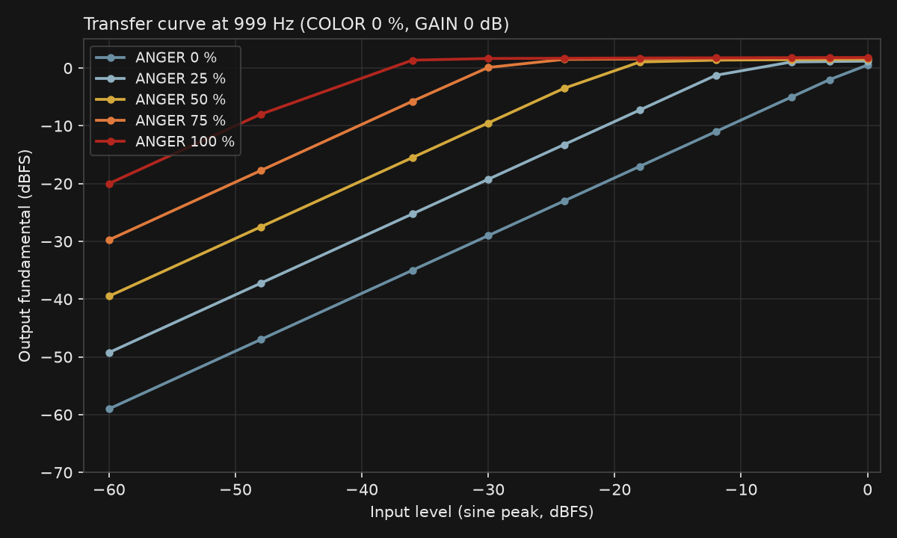
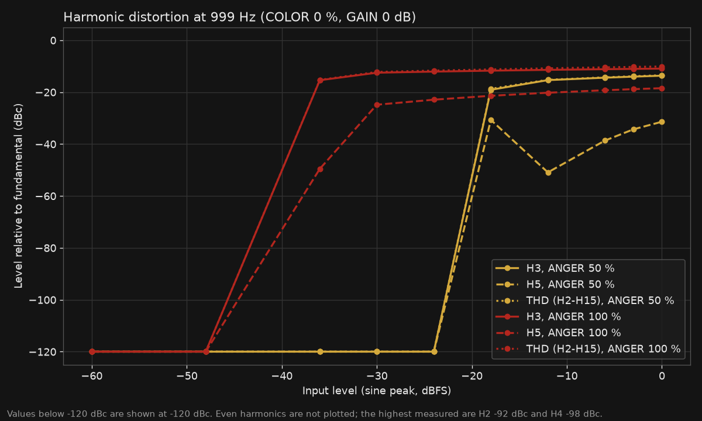
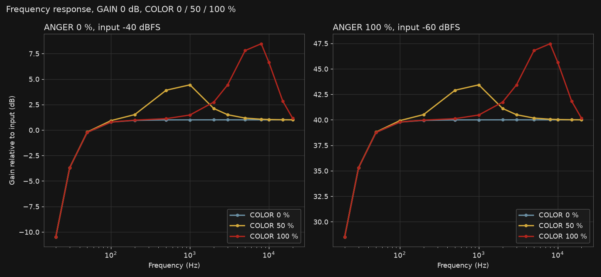
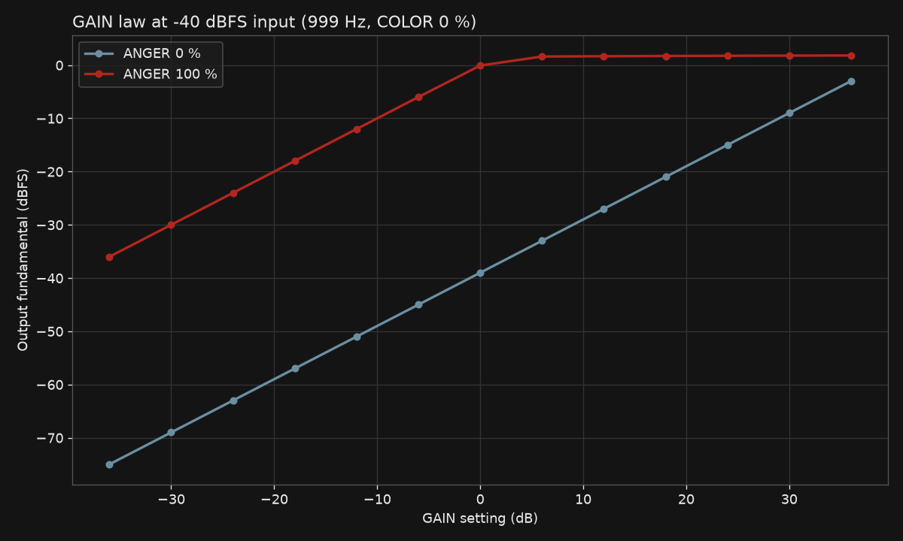
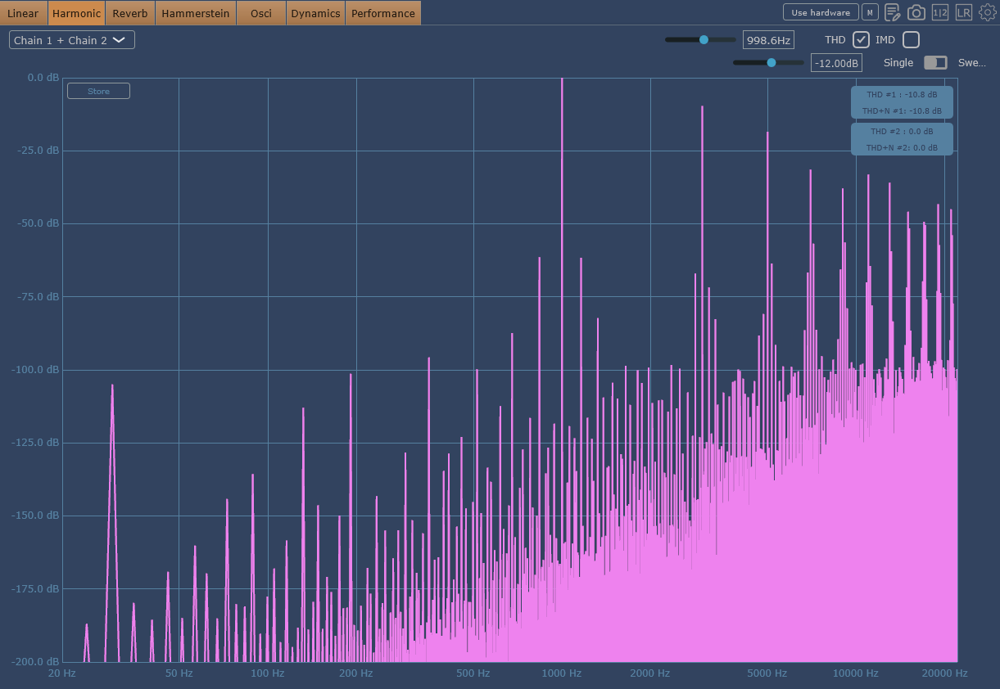
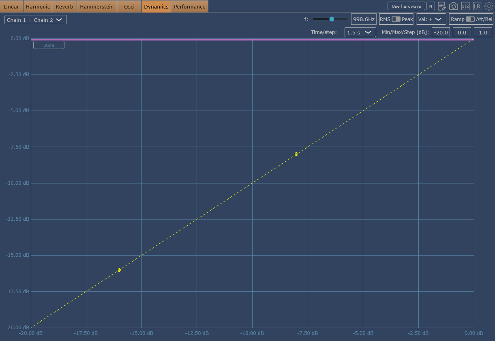
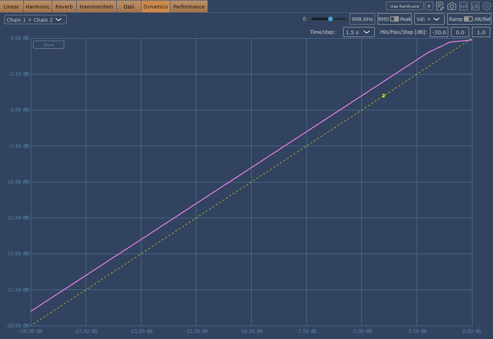
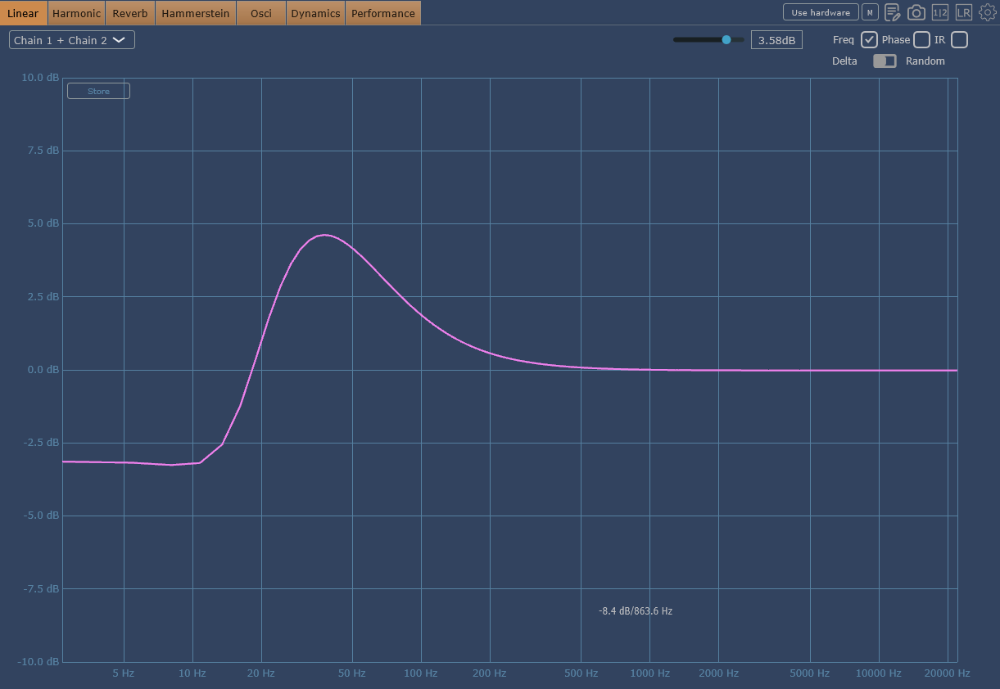

# ANGRY PIG

**Make your sound filthy. Keep your wallet clean.**

Free saturation and distortion plugin

  

[**Download Angry Pig 1.0.0 for Windows**](https://github.com/Rafthouse/angry-pig/releases/tag/v1.0.0)

---

## About

Angry Pig adds saturation, grit and tonal colour to a stereo signal. It has four controls: how hard the signal is driven, how the tone is shaped, how much level goes into the saturation stage, and a bypass. Use it on drums, bass, synthesizers, vocals or a mix bus when you want density and character without a complicated interface.

Angry Pig was designed and built by its author, Mykyta Shchur. It is free to download and use.

## Controls

| Control | Range | What it does |
| --- | --- | --- |
| **ANGER** | 0 to 100 % | Drives the signal into the saturation stage, adding up to 39 dB of drive at 100 %. A level detector applies gain reduction on loud peaks, so the output rises more slowly than the drive. |
| **COLOR** | 0 to 100 % | Shapes the tone before the drive stage with a peaking filter. Higher settings move a boost of up to about 8 dB from roughly 1 kHz to roughly 8 kHz. |
| **GAIN** | -24 to +18 dB | Sets the level going into the saturation stage. At high drive the saturation curve limits the output, so GAIN is less audible on a heavily saturated signal. |
| **BYPASS** | on / off | Passes the input through unchanged. |

Technical details, measured values and the signal path are in [docs/technical](docs/technical/README.md).

## Features

- Stereo VST3 plugin with four parameters that can be automated from the host.
- Low-frequency high-pass filtering on each channel before the drive stage, with a corner near 30 Hz.
- Saturation stage with a smooth transfer curve and an output that approaches about -0.1 dBFS at its peaks.
- Level meter with -12, -6, 0 and +6 dB indicators and a CLIP light for the signal entering the saturation stage.
- Parameter values are stored with the host project.

## Use cases

- **Drums:** more presence and snap on snares, kicks and percussion. Start with ANGER low and raise it until the transients feel fuller.
- **Bass:** warmth and audible harmonics that help a bass line cut through on small speakers. Keep COLOR moderate.
- **Synthesizers:** add grit to pads, leads and basses, or run a chord through it for a dirtier tone.
- **Mix bus and vocals:** subtle colour at low ANGER values, and character when pushed.

## Screenshots

| Default | Moderate drive | High drive |
| --- | --- | --- |
|  |  |  |
| ANGER 0 %, COLOR 0 %, GAIN 0 dB | ANGER 39.3 %, COLOR 34.0 %, GAIN 0 dB | ANGER 100 %, COLOR 34.0 %, GAIN 0 dB |

## Measurements

These plots come from measurements of the Windows 1.0.0 plugin. The full tables and conditions are in [docs/measurements](docs/measurements/README.md).

| Transfer curve | Harmonic distortion |
| --- | --- |
|  |  |
| Frequency response | GAIN law |
|  |  |

Plugin Doctor graphs, captured from the same build:

| Harmonic analysis (THD -10.8 dB at -12 dBFS, ANGER 100 %) | Transfer curve (ANGER 100 %) |
| --- | --- |
|  |  |
| Transfer curve (ANGER 0 %) | Linear view (ANGER 0 %, broadband excitation) |
|  |  |

The Plugin Doctor linear view uses broadband excitation and does not match the sine-based frequency response below about 100 Hz. The [measurement notes](docs/measurements/README.md#plugin-doctor-graphs) explain the difference.

## Downloads

| Platform | Format | Status |
| --- | --- | --- |
| Windows 10 and 11, 64-bit | VST3 (installer and bundle) | **1.0.0 available** from the [Releases](https://github.com/Rafthouse/angry-pig/releases/tag/v1.0.0) page |
| macOS, Apple Silicon | VST3 | Planned, not yet released |
| macOS, Apple Silicon | Audio Unit (AUv2) | Planned, not yet released |

Each release lists the SHA-256 checksum of every file. Check the checksum before you run an installer.

## Installation

Windows 10 or 11 (64-bit) with a host that supports VST3, and the Microsoft Edge WebView2 Runtime. Most current Windows systems already have the runtime.

1. Close your DAW and plugin hosts.
2. Run `AngryPig-Setup-1.0.0-UNSIGNED.exe` and follow the steps. The installer copies the VST3 bundle to `C:\Program Files\Common Files\VST3\` and can uninstall it later.
3. Rescan plugins in your host. Angry Pig appears as **Angry Pig 1.0**.

The installer is not code-signed yet. Windows SmartScreen may warn you. Verify the checksum first. Full instructions, including the bundle-only option and troubleshooting, are in [docs/INSTALLATION.md](docs/INSTALLATION.md).

## Documentation

- [User guide](docs/USER_GUIDE.md): what each control does, levels, examples, troubleshooting
- [Technical documentation](docs/technical/README.md): signal path, saturation behaviour, gain staging, limitations
- [Measurements](docs/measurements/README.md): conditions, tables and data files
- [Release notes 1.0.0](docs/RELEASE_NOTES_1.0.0.md): changes, known limitations, checksums
- [Third-party notices](docs/THIRD_PARTY_NOTICES.md): components and licenses

## Compatibility

| Item | Angry Pig 1.0.0 |
| --- | --- |
| Operating system | Windows 10 and 11, 64-bit |
| Format | VST3 |
| Channels | Stereo only. Mono is not supported. |
| Sample rates | Accepted by the plugin from 8 kHz to 384 kHz. Measurements were made at 44.1 kHz. |
| Latency | Reported as 0 samples |
| Oversampling | None. Heavy drive can alias high frequencies. |
| Host testing | Ableton Live 12 Suite was used to check loading, the interface and the controls. Testing in other hosts has not been completed. |

## Validation

- VST3 Validator: 47 of 47 tests passed on the Windows 1.0.0 bundle.
- The four parameter identifiers, default values and ranges were checked on the built plugin.
- Measurements summarised above and in [docs/measurements](docs/measurements/README.md).

Not yet verified: macOS builds, automation and project recall across DAWs, and a clean installation on a fresh Windows virtual machine.

## Support development

Angry Pig is free to use. If it is useful to you, optional donations help fund future releases. A donation link will be added here by the author.

## Credits and licensing

Created by **Mykyta Shchur**. © 2026 Mykyta Shchur. The interface, visual design and artwork are original works of the author.

Angry Pig uses third-party components, including the iPlug 2 framework and the VST 3 SDK. They are listed with their licenses in [docs/THIRD_PARTY_NOTICES.md](docs/THIRD_PARTY_NOTICES.md) and included in each distribution.

**Source code is not published in this repository and is not licensed for reuse.** The author retains all rights to the source code and artwork. The compiled plugin is free to download and use. Redistribution terms beyond free binary distribution have not been published.

## Feedback

Bug reports and feature requests are welcome in the [issue tracker](https://github.com/Rafthouse/angry-pig/issues). Please use the templates and include your host, operating system and plugin version.
