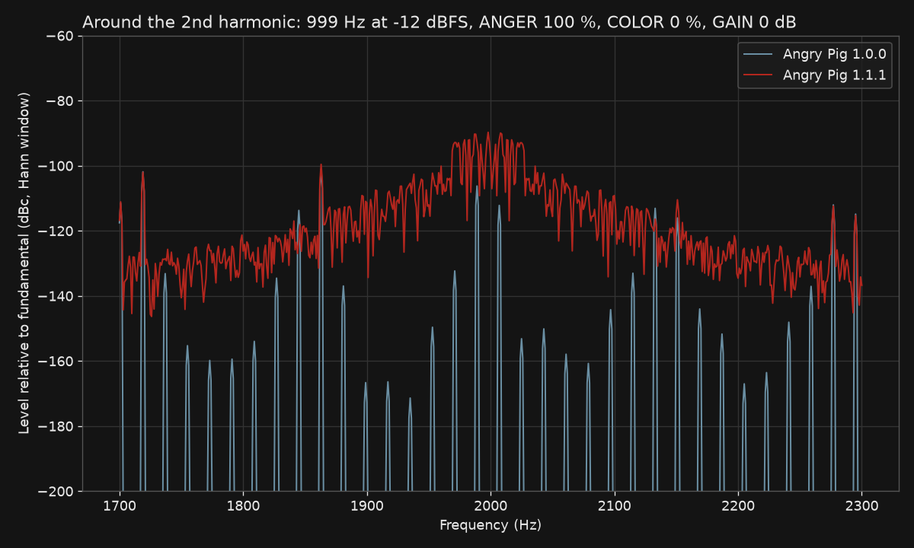

# Dynamic saturation (new in 1.1.1)

Angry Pig 1.1.1 adds two small, signal-dependent movements to the saturation stage. They give the sound a live, slightly moving character around the harmonics, the "halo". They do not change the level, the transfer curve or the odd harmonics. Angry Pig 1.0.0 has neither of them.

## What it does (implementation)

Both terms are added to the signal just before the saturation curve. The source is `src/native/APDynamicSaturation.h`.

| Term | What it is | Effect |
| --- | --- | --- |
| **A: operating-point bias** | A very slow additive offset (below 0.1 Hz). | Moves the operating point of the curve slightly. This adds a small second harmonic, about -92 to -96 dBc when the stage saturates. |
| **B: halo** | Seeded noise, low-pass filtered at 32 Hz (2nd-order Butterworth), scaled by the level of the input (1 ms average of the input magnitude). | Spreads a little energy to about ±30 Hz around each harmonic. This is the halo. It follows the input level: louder input, more halo; silence, none. |

A third term from the development builds (C, a broadband background) is off. It raised the noise floor without adding to the halo.

There is no control for the dynamic saturation. It is always on and needs no setting.

- The noise is seeded, so a render is repeatable: the same input and settings give the same output, bit for bit.
- Digital silence in gives digital silence out.
- The output does not depend on the host's block size.
- It needs about 15 extra operations per sample and channel. The whole plug-in uses about 0.5 % of one CPU core at 44.1 kHz.

## Measured

999 Hz sine at -12 dBFS, ANGER 100 %, COLOR 0 %, GAIN 0 dB, 44.1 kHz. Halo = energy 1 to 127 Hz away from the even harmonics H2 to H14, relative to the fundamental, mean of ten 1 s windows. Tool: `tools/parity/halo_metrics.py`.

| Value | Angry Pig 1.0.0 | Angry Pig 1.1.1 |
| --- | --- | --- |
| Halo | -95.38 dBc (fixed, no movement) | **-75.82 dBc** |
| Low frequencies 20 to 200 Hz | -106.7 dBc | -83.38 dBc |
| H3 | -11.42 dBc | -11.42 dBc |
| H5 | -20.23 dBc | -20.23 dBc |
| Odd harmonics H3 to H15 | -11.42 to -47.61 dBc | identical to 1.0.0 (within 0.0001 dB) |
| Output level | | identical to 1.0.0 (difference 0.00 dB) |
| DC | below -300 dBc | -112.5 dBc |

The plot shows the spectrum around the second harmonic (2 kHz) for both versions. 1.0.0 has a few fixed, narrow lines. 1.1.1 has a continuous skirt about ±30 Hz wide, about 75 dB below the fundamental.

At ANGER 0 % the halo is still present, but very low: the difference between 1.1.1 and 1.0.0 is about -75 dB relative to the output signal at every setting tested. The measured distortion floor at low drive is therefore about -134 dB (THD H2 to H15) instead of about -173 dB in 1.0.0. The [measurement tables](../measurements/README.md) show this floor.
